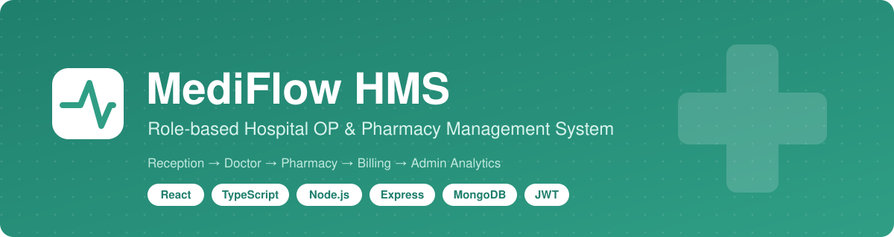
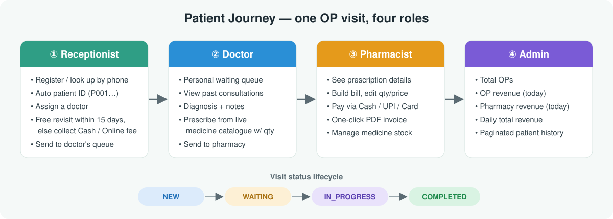
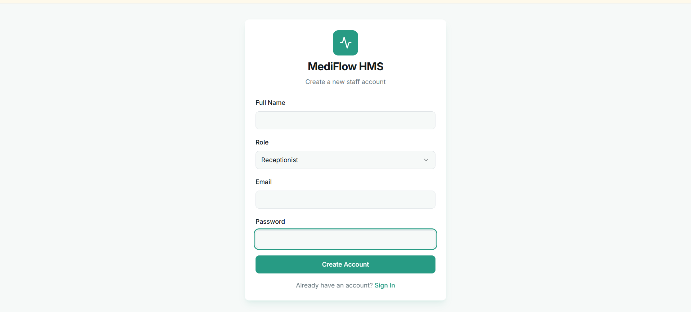
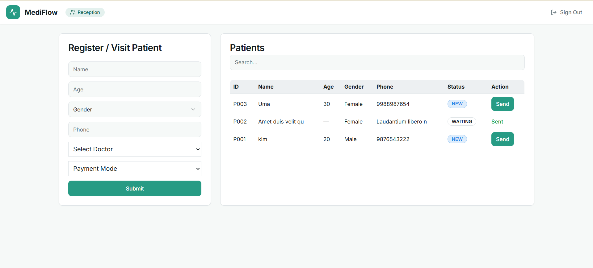
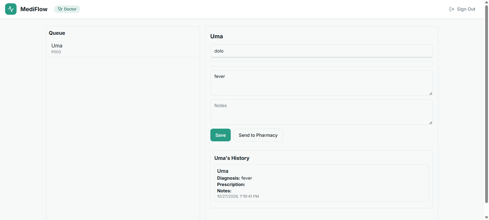
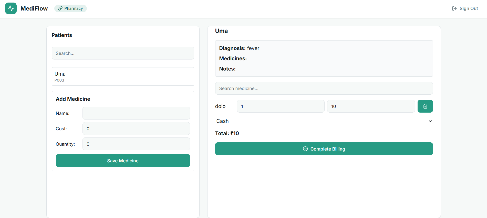
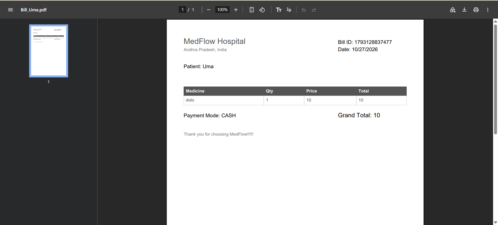
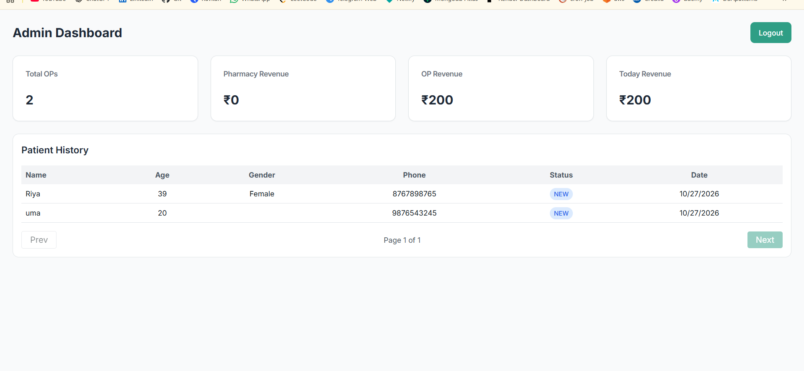
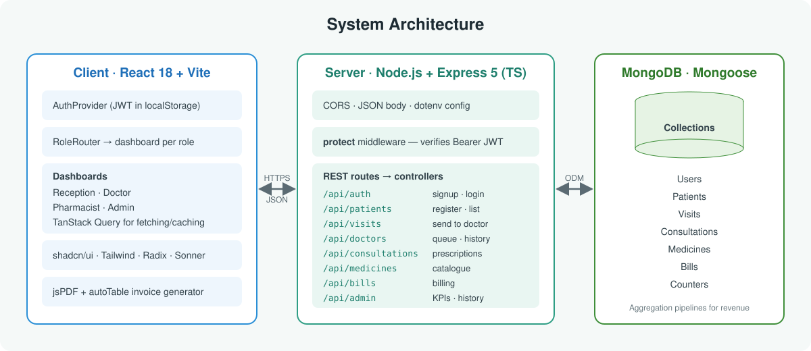
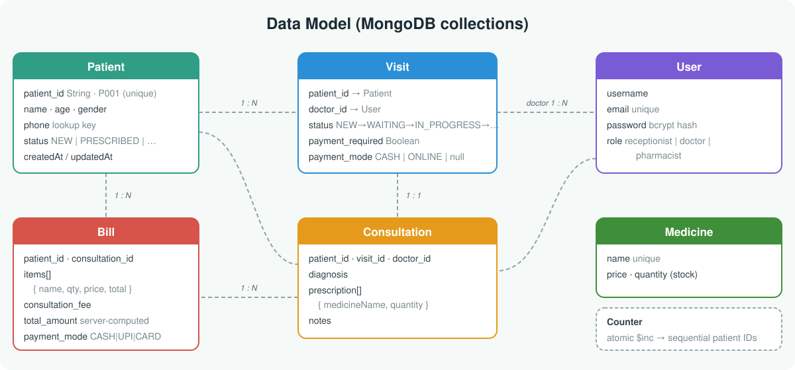

<p align="center">
  
</p>

<p align="center">
  
  
  
  
  
  
  
  
</p>

<p align="center">
  <a href="https://frabjous-zuccutto-e25bf6.netlify.app"><b>🔗 Live Demo</b></a> ·
  <a href="#-features">Features</a> ·
  <a href="#-architecture">Architecture</a> ·
  <a href="#-api-reference">API</a> ·
  <a href="#-getting-started">Run Locally</a>
</p>

---

## 📌 Overview

**MediFlow HMS** is a full-stack hospital management system for **outpatient (OP) clinics**. It digitises a full patient visit: front-desk registration, doctor consultation, pharmacy billing and management reporting.

Each staff member signs in and gets a **dashboard built for their role**. A patient moves through the system like a ticket: the receptionist registers them and sends them to a doctor's queue. The doctor diagnoses and prescribes, then sends them to the pharmacy. The pharmacist bills the medicines and prints a PDF invoice. The admin sees revenue and footfall in real time.

> **Problem it solves:** Small clinics often track patients on paper registers and handwritten prescriptions. That leads to lost records, billing mistakes and no view of daily revenue. MediFlow replaces this with one connected workflow and an auditable history for every patient.

---

## 🔄 How It Works

<p align="center">
  
</p>

---

## 📸 Screenshots

<table>
  <tr>
    <td align="center" width="50%">
      <br/>
      <b>Login / Sign Up</b><br/>
      <sub>Staff sign in and are routed to the dashboard for their role</sub>
    </td>
    <td align="center" width="50%">
      <br/>
      <b>Receptionist Dashboard</b><br/>
      <sub>Register patients, apply the 15-day free-revisit rule, send to a doctor</sub>
    </td>
  </tr>
  <tr>
    <td align="center" width="50%">
      <br/>
      <b>Doctor Dashboard</b><br/>
      <sub>Personal queue, patient history, diagnosis and prescription</sub>
    </td>
    <td align="center" width="50%">
      <br/>
      <b>Pharmacist Dashboard</b><br/>
      <sub>Prescription view, bill builder and medicine inventory</sub>
    </td>
  </tr>
  <tr>
    <td align="center" width="50%">
      <br/>
      <b>PDF Invoice</b><br/>
      <sub>Downloaded automatically when billing is completed</sub>
    </td>
    <td align="center" width="50%">
      <br/>
      <b>Admin Dashboard</b><br/>
      <sub>OP and pharmacy revenue KPIs with paginated patient history</sub>
    </td>
  </tr>
</table>

---

## ✨ Features

### 🧑‍💼 Receptionist
- **Register or look up patients by phone number.** Returning patients are recognised automatically.
- **Sequential, human-readable patient IDs** (`P001`, `P002`, …), generated with an atomic MongoDB counter so two registrations can never get the same ID.
- **Smart consultation-fee rule:** a revisit **within 15 days is free**. Otherwise the payment mode (Cash / Online) is required. The UI checks this live as the phone number is typed.
- Assign a doctor and **send the patient to that doctor's queue**.
- Searchable patient list (by name, ID or phone) with colour-coded status badges.

### 🩺 Doctor
- **A personal waiting queue** that shows only the patients assigned to the signed-in doctor (identified from the JWT).
- **Patient history:** every past consultation with diagnosis, prescription and notes.
- **Type-ahead medicine search** against the live pharmacy catalogue, with a quantity for each medicine.
- Record diagnosis and clinical notes, then **send the patient to the pharmacy** in one click.

### 💊 Pharmacist
- A queue of prescribed patients, with the doctor's diagnosis and prescription shown next to the bill.
- **Build the bill:** add medicines from the catalogue, edit quantity and price, and see the total update as you go.
- Payment modes **Cash / UPI / Card**.
- **Generates a branded PDF invoice** (jsPDF + autoTable) when billing is completed.
- **Inventory management:** add new medicines with price and stock quantity.

### 📊 Admin
- KPI cards: **Total OPs, OP revenue, pharmacy revenue and today's total revenue**.
- Revenue is computed server-side with **MongoDB aggregation pipelines** (`$unwind` → `$group` → `$sum`).
- **Paginated patient history** with status tracking.

### 🔐 Cross-cutting
- **JWT authentication** (7-day tokens) with **bcrypt** password hashing.
- **Role-based routing**: one `/` route renders the correct dashboard for the signed-in role.
- Protected API routes through an Express `protect` middleware.
- Toast notifications, loading states and a consistent design system (shadcn/ui).

---

## 🏗 Architecture

<p align="center">
  
</p>

The project is a **monorepo** with two independently deployable apps:

| Layer | Hosting | Responsibility |
|---|---|---|
| `client/` | Netlify | React SPA, with a role-specific UI per user |
| `server/` | Render | REST API, auth, business rules (free-revisit window, bill totals, revenue) |
| Database | MongoDB Atlas | Persistent storage through Mongoose models |

---

## 🗃 Data Model

<p align="center">
  
</p>

**Design decisions**
- **`Patient` and `Visit` are separate.** A patient is created once, and each hospital trip is a new `Visit`. This keeps the full visit history and makes the 15-day free-revisit rule possible.
- **The visit status machine** (`NEW → WAITING → IN_PROGRESS → COMPLETED`) controls which dashboard queue a patient appears in.
- **Bill totals are recalculated on the server.** The server does not trust the client total: it computes `quantity × price` for each item and adds the consultation fee.

---

## 🧰 Tech Stack

| Category | Technologies |
|---|---|
| **Frontend** | React 18, TypeScript, Vite, React Router v6 |
| **State / Data** | TanStack React Query (caching, mutations, cache invalidation), Context API for auth |
| **UI** | Tailwind CSS, shadcn/ui, Radix UI primitives, Lucide icons, Sonner toasts |
| **Documents** | jsPDF, jspdf-autotable (invoice generation) |
| **Backend** | Node.js, Express 5, TypeScript, ts-node-dev |
| **Database** | MongoDB, Mongoose ODM (references, populate, aggregation) |
| **Security** | JSON Web Tokens, bcrypt, CORS |
| **Tooling** | ESLint, Vitest, Playwright, PostCSS |
| **Deployment** | Netlify (client), Render (API), MongoDB Atlas |

---

## 📡 API Reference

Base URL: `/api`. 🔒 = requires `Authorization: Bearer <token>`.

| Method | Endpoint | Description |
|---|---|---|
| `POST` | `/auth/signup` | Create a staff account (receptionist / doctor / pharmacist) |
| `POST` | `/auth/login` | Sign in and receive a JWT and role |
| `GET` | `/patients` | List patients with the status of their latest visit |
| `POST` | `/patients` | Register a patient (or reuse one by phone) and open a new visit |
| `GET` | `/patients/check-payment?phone=` | Check whether the consultation fee applies (15-day rule) |
| `PUT` | `/visits/send` | Move the latest visit into the doctor's queue (`WAITING`) |
| `GET` | `/doctors` | List all doctors |
| `GET` | `/doctors/queue` 🔒 | Waiting patients for the signed-in doctor |
| `POST` | `/doctors/consultation` 🔒 | Save diagnosis, prescription and notes |
| `PUT` | `/doctors/send` | Send the visit to the pharmacy (`IN_PROGRESS`) |
| `GET` | `/doctors/history?patient_id=` 🔒 | A doctor's consultation history, optionally for one patient |
| `GET` | `/consultations/:patientId` 🔒 | Consultations for a patient |
| `GET` | `/medicines` 🔒 | Medicine catalogue |
| `POST` | `/medicines` 🔒 | Add a medicine with price and stock |
| `POST` | `/bills` 🔒 | Create a bill (total computed on the server) |
| `GET` | `/admin/dashboard` | KPIs and revenue aggregates |
| `GET` | `/admin/patients-history?page=` | Paginated patient list |

---

## 📁 Project Structure

```
heal-hub-stream/
├── client/                     # React + Vite frontend
│   └── src/
│       ├── pages/              # Login + one dashboard per role
│       │   ├── ReceptionistDashboard.tsx
│       │   ├── DoctorDashboard.tsx
│       │   ├── PharmacistDashboard.tsx
│       │   └── AdminDashboard.tsx
│       ├── hooks/useAuth.tsx   # Auth context (login, signup, logout, role)
│       ├── components/         # AppLayout + shadcn/ui components
│       └── utils/pdfGenerator.ts  # Invoice PDF builder
│
├── server/                     # Express + TypeScript API
│   ├── models/                 # Mongoose schemas (User, Patient, Visit, …)
│   ├── controllers/            # Business logic
│   ├── routes/                 # REST route definitions
│   ├── middleware/authMiddleware.ts  # JWT guard
│   └── index.ts                # App entry point
│
└── docs/images/                # README diagrams
```

---

## 🚀 Getting Started

### Prerequisites
- Node.js 18+
- A MongoDB connection string (local or [MongoDB Atlas](https://www.mongodb.com/atlas))

### 1. Clone
```bash
git clone https://github.com/bhoomikaaa20/heal-hub-stream.git
cd heal-hub-stream
```

### 2. Start the API
```bash
cd server
npm install
```
Create `server/.env`:
```env
MONGO_URI=mongodb+srv://<user>:<password>@<cluster>/<db>
JWT_SECRET=<any-long-random-string>
PORT=5000
```
```bash
npm run dev        # http://localhost:5000
```

### 3. Start the client
```bash
cd ../client
npm install
npm run dev        # http://localhost:8080
```

### 4. Try it out
1. Click **Sign Up** and create one account each for **Receptionist**, **Doctor** and **Pharmacist**.
2. As the **pharmacist**, add a few medicines to the catalogue.
3. As the **receptionist**, register a patient, assign the doctor and click **Send**.
4. As the **doctor**, open the patient from the queue, prescribe medicines and click **Send to Pharmacy**.
5. As the **pharmacist**, select the patient, build the bill and click **Complete Billing**. The PDF invoice downloads automatically.
6. Sign in as **admin** to see the revenue dashboard.

---

## 🧠 What I Learned / Engineering Highlights

- Modelled a **real-world, multi-actor workflow** as a status-driven state machine across separate dashboards.
- Used **MongoDB aggregation pipelines** for revenue analytics instead of computing totals on the client.
- Generated **race-free sequential IDs** with an atomic `findOneAndUpdate` + `$inc` counter document.
- Used **TanStack Query** for server state, so each mutation invalidates the right queries and every dashboard stays up to date.
- Generated **PDF invoices in the browser**, with no server-side rendering needed.
- Kept the API **fully typed** with TypeScript on both ends.

## 🛣 Roadmap

- [ ] Role-based authorisation on every route (not just authentication)
- [ ] Deduct medicine stock automatically at billing and add low-stock alerts
- [ ] Move the API base URL into an environment variable (`VITE_API_URL`)
- [ ] Revenue trend charts on the admin dashboard (data already returned as `revenueByDate`)
- [ ] Appointment scheduling and SMS / WhatsApp notifications
- [ ] Unit and E2E tests (Vitest and Playwright are already configured)

---

## 👩‍💻 Author

**Bhoomika Somavarapu**
GitHub: [@bhoomikaaa20](https://github.com/bhoomikaaa20)

If you found this project interesting, please consider giving it a ⭐!
